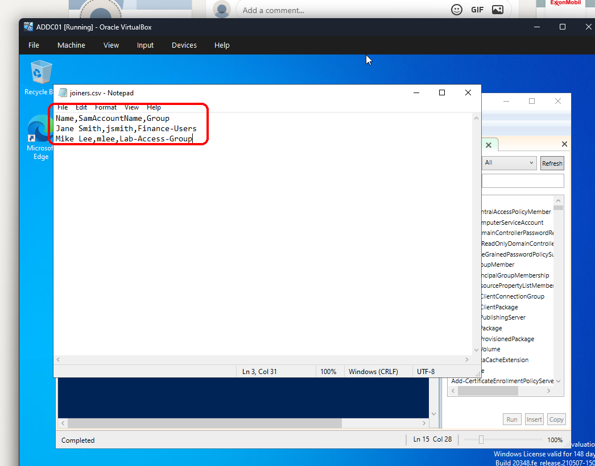
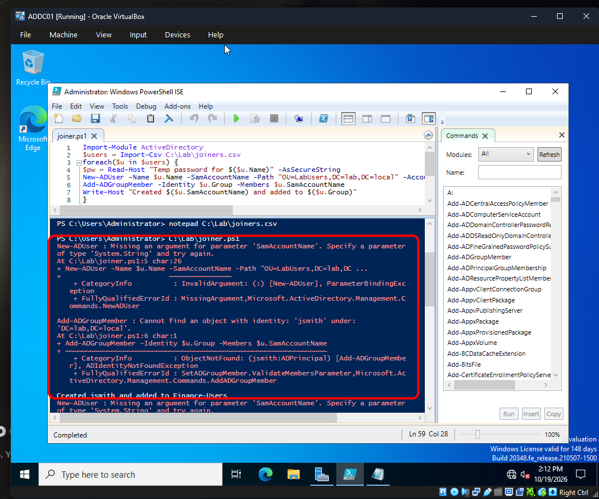
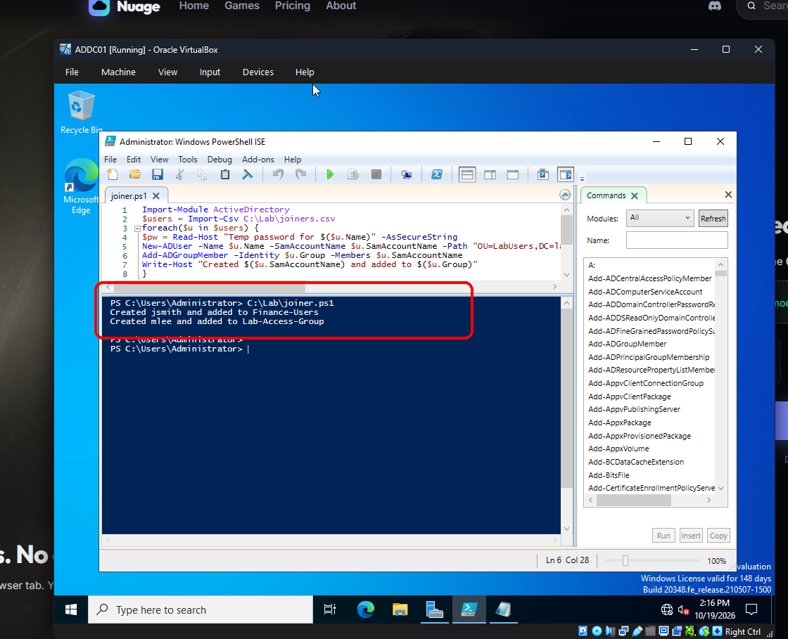
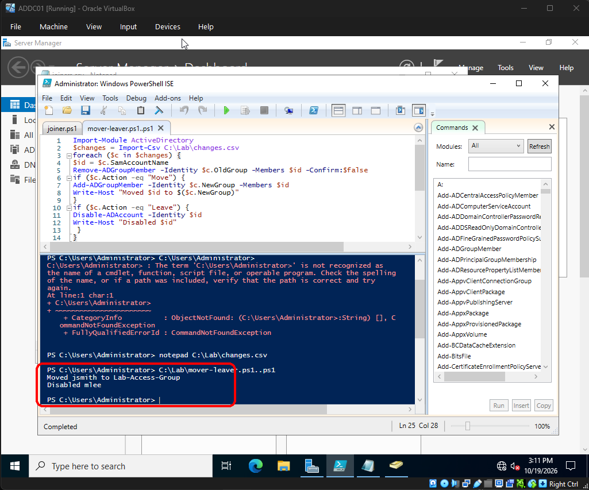
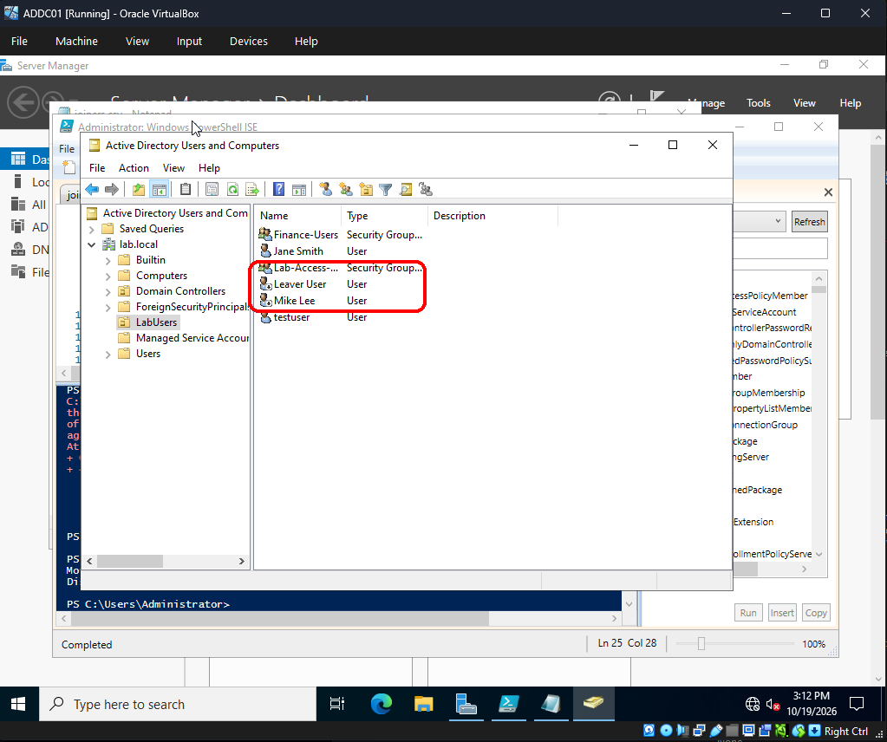
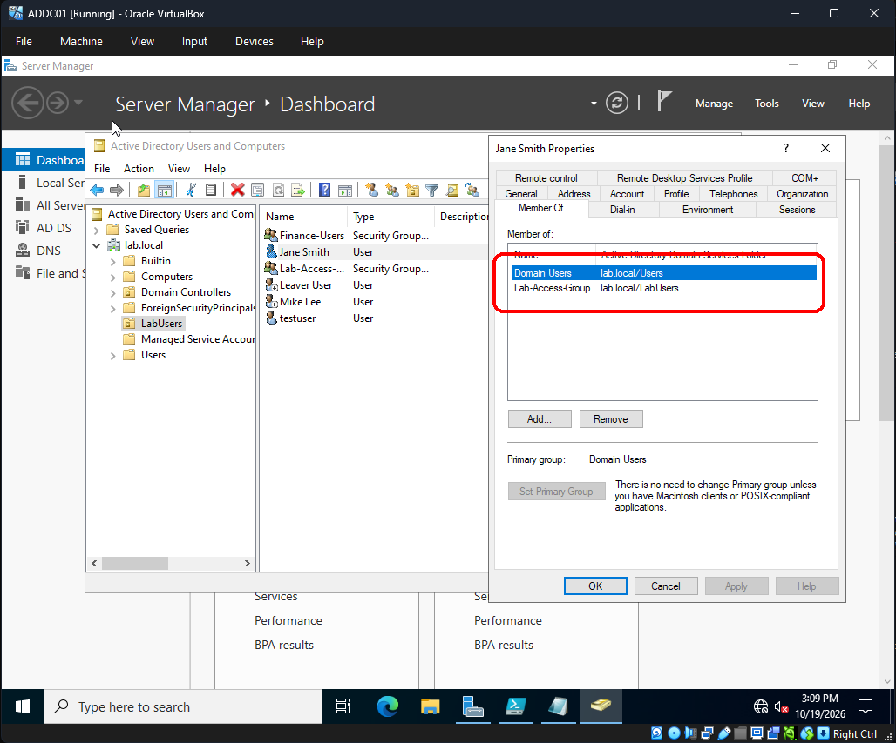
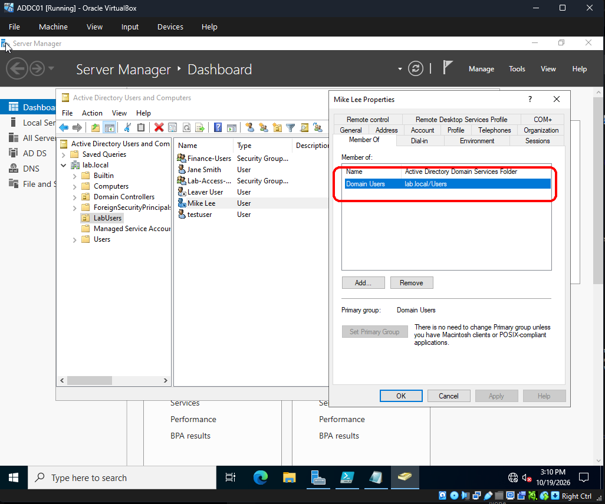
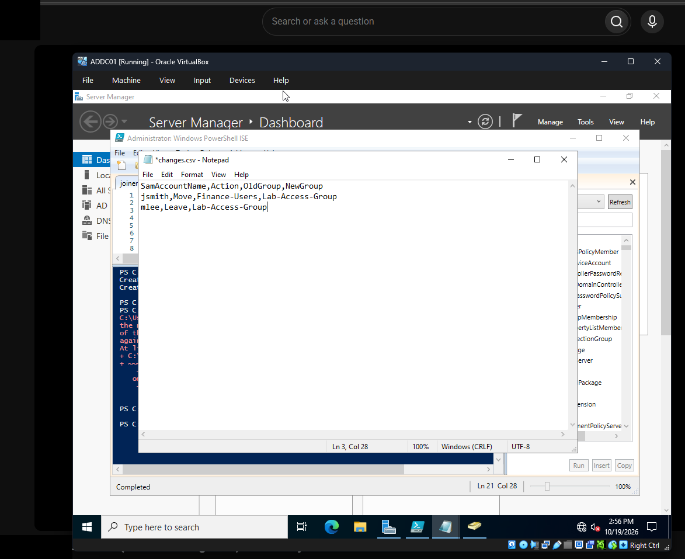

# PowerShell Joiner-Mover-Leaver Automation (Active Directory)

Hands-on lab, Oct 2026. This automates what I did by hand in my [AD user lifecycle lab](https://github.com/salamraghe/ad-user-lifecycle).

Three everyday access tickets: a joiner (new hire), a mover (role change) and a leaver (offboarding). HR-style CSV files go in, and PowerShell creates, moves or disables the accounts in Active Directory, the same way every time.

## What I built

- **Joiner:** `joiners.csv` → script creates Jane Smith (`jsmith`) and Mike Lee (`mlee`) in `OU=LabUsers` and adds each to a starting group. The temp password is prompted as a secure string, never stored in a file.
- **Mover / leaver:** [`scripts/changes.csv`](scripts/changes.csv) + [`scripts/mover-leaver.ps1`](scripts/mover-leaver.ps1). The old group is removed first, then the mover gets the new group or the leaver is disabled.
- Verified in ADUC: jsmith moved from Finance-Users to Lab-Access-Group, and mlee was disabled with only Domain Users left.

## What I learned

In my own words:

> "With a script, HR passes me a CSV once, I run it, and every user is built the same way without clicking, in a couple of minutes. It's faster, has fewer mistakes, and every user is set up the same way."

> "My script moved Jane by taking her out of Finance, so no more access there, and putting her in her new role's Lab-Access-Group. For Mike, I took him out of Lab-Access-Group and disabled his account, because he left the company, or might have had a breach, or is on a 3-4 month break."

*Coach-written at his request:* the old group is removed first to prevent privilege creep and keep least privilege.

*Interview line (coach-written at his request, from his one-page IAM Labs doc):*

> "HR gives me one CSV, I run my joiner script, and every user is built the same way in a couple of minutes with fewer mistakes. My mover/leaver script takes the old group off first, adds the new one, and disables leavers, and I check every result in AD because the script can print 'Created' even when it failed."

## Key screenshots

*Joiners CSV lists each new hire's name, username and starting group.*

*PowerShell script reads the CSV, creates AD users and adds groups.*

*Error I hit on the first run, which I debugged and fixed.*

*Fixed script created both users and added them to their groups.*

*Mover and leaver script moved jsmith and disabled mlee from a CSV.*

*Active Directory shows leaver Mike Lee's account disabled after the script ran.*

*Mover jsmith after the move: Lab-Access-Group added, Finance-Users gone (before shot is in Full proof).*

*Leaver mlee is left with only Domain Users after group removal.*

## Environment

| Item | Value |
| --- | --- |
| Domain controller | ADDC01 (Windows Server VM in VirtualBox) |
| Domain / OU | `lab.local` / `LabUsers` |
| Tool | Windows PowerShell ISE (Administrator), ActiveDirectory module |
| Groups | `Finance-Users`, `Lab-Access-Group` |
| Users | Jane Smith (`jsmith`), Mike Lee (`mlee`) |

## What broke / issues I fixed

- **Typo `$u.uName`.** Fixed the property name.
- **Missing `-SamAccountName` value:** `New-ADUser : Missing an argument for parameter 'SamAccountName'`, so `Add-ADGroupMember` couldn't find the users. Added `$u.SamAccountName`.
- **Typed the PS prompt as a command** (`C:\Users\Administrator>` not recognized). Ran the script path on its own.
- **`$c.NewGroup` instead of `$c.OldGroup`** on the Remove line. I caught it in review before running.
- **Lesson:** `Write-Host` printed "Created" even when `New-ADUser` failed. A success message isn't proof, so I always verify in ADUC.

## Gaps

- Two users, one lab domain. No error handling or logging in the script yet. The joiner script is shown in screenshots only (line 5 is cut off on screen), so it isn't retyped as a file.
- The VM taskbar clock is native to the screenshots; nothing was added. Background browser content was blacked out.

Full proof (all screenshots)

